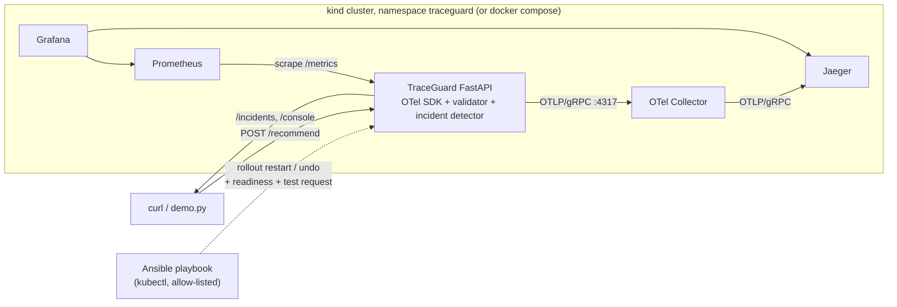

# TraceGuard.

AI observability and controlled self-healing on Kubernetes, demonstrated with a deterministic, AI-like recommendation API.

## Verification status (read this first)

What was **actually run** while building this on a Windows 11 machine with Python 3.12 only:

| Layer | Status |
|---|---|
| FastAPI app, fault injection, correctness validator, incident detector | **Run.** 38 pytest tests pass (`python -m pytest`). |
| OpenTelemetry spans exported over OTLP/gRPC | **Run against a stand-in receiver.** `tests/test_otlp_export.py` starts the real app and checks the spans, trace ID and `service.name` that arrive over gRPC. |
| Scenarios A, B, C against a live uvicorn process | **Run** (`scripts/demo.py`, output below). |
| Prometheus `/metrics` endpoint | **Run** (scraped with curl). Prometheus itself was **not** run. |
| Collector -> Jaeger, Prometheus, Grafana, Docker image, docker compose | **Not run.** Docker is not installed on the build machine. Configs are YAML/JSON-parse checked only. |
| Kubernetes manifests, kind, port-forward, pod deletion (scenario D) | **Not run.** No kubectl/kind. |
| Ansible playbook (scenario E) | **Not run.** Ansible cannot run on a Windows control node; structure was reviewed by hand only. |

`scripts/verify.sh` reports PASS/FAIL/SKIP per check and prints the exact command for every SKIP. Run it on a machine with Docker + kind + Ansible to close the gap; expect to fix small issues in the unrun layers.

## Problem

Dashboards say "healthy" while users get slow, intermittently failing, or **wrong** answers. TraceGuard shows four failure shapes (normal, slow, failing, silently incorrect), how traces + metrics + logs + outcome validation expose each, and how Kubernetes and an operator-run Ansible workflow recover from them.

## Architecture



Collector pipeline (`observability/otel-collector.yaml`): `otlp receiver (4317 gRPC, 4318 HTTP) -> memory_limiter -> batch -> exporters [otlp/jaeger, debug]`, with a `health_check` extension on `:13133`.

## Tech stack

| Component | Why |
|---|---|
| Python + FastAPI | Small, typed API; easy to instrument. |
| OpenTelemetry SDK + `opentelemetry-instrumentation-fastapi` | Vendor-neutral traces; the same telemetry can go to Jaeger today and another backend later by changing the Collector exporter. |
| OTel Collector | Decouples the app from backends (batching, retry, fan-out). |
| Jaeger | Simple trace UI. |
| Prometheus + `prometheus_client` | Low-cardinality metrics (rates, p95 from histograms, readiness, correctness, incident counts). |
| Grafana | Provisioned dashboard `TraceGuard overview` (11 panels, all PromQL against live data). |
| Docker, kind (or Minikube), kubectl | Local Kubernetes; probes, resources, rolling updates, pod recreation. |
| Ansible | Auditable, repeatable operator workflow with validation, check mode and verification. |

Ports: app 8000, Jaeger UI 16686, Prometheus 9090, Grafana 3000, Collector OTLP 4317/4318 (health 13133, compose publishes 4317/4318). Dependency chain: app -> collector -> jaeger; prometheus -> app; grafana -> prometheus, jaeger.

## Application

| Endpoint | Purpose |
|---|---|
| `GET /health` | Liveness. |
| `GET /ready` | Readiness. |
| `POST /recommend` | `{user_id, category, budget}` -> best in-stock product within budget, plus a `correctness` verdict and `trace_id`. |
| `POST /simulate-failure` | Fault injection (`slow`, `error`, `wrong_result`, `not_ready`, `unhealthy`, `crash`, `none`). **Returns 403 unless `TRACEGUARD_ENV=local` and `TRACEGUARD_ENABLE_FAULT_INJECTION=true`.** Default environment is `production`, so the safe default is "off"; a flag alone is not enough. |
| `GET /metrics` | Prometheus metrics. |
| `GET /incidents`, `GET /console` | Incident records (JSON) and a small live HTML console with Jaeger links. |

Spans per request: server span (FastAPI instrumentation) with children `recommend.validate_input`, `lookup_catalog`, `compute_recommendation`, `validate_business_rules`, `build_response`. Each child has `traceguard.operation`, `traceguard.status`, `traceguard.duration_ms`, `traceguard.fault_scenario`. Health/ready/metrics are excluded from tracing. User IDs are stored only as a truncated SHA-256 span attribute; metric labels are bounded enums (route template, method, status, scenario, result, incident type). Logs are JSON with `trace_id`/`span_id`.

**Correctness check:** the pipeline's choice is compared with an independent golden reference (`domain.expected_recommendation`) plus invariants (in budget, in stock). `wrong_result` simulates a stale ranking that serves the runner-up: HTTP 200, healthy probes, wrong answer.

**Incident rules** (`app/incident_detection.py`, deterministic, offline, thresholds from env): p95 latency > 1000 ms; 5xx rate > 20%; any incorrect outcome in the window (threshold 0); readiness false. Window: last 50 `/recommend` requests, minimum 5 samples for latency/error rules. Each incident has type, detection time, severity, evidence, trace ID (a real one from an affected request, or `null`), investigation steps, remediation, and `root_cause_confirmed: false`. These are **symptoms**; a trace is an example, not proof of cause.

## Setup

### Prerequisites

- Always: Python 3.11+.
- Compose path: Docker + Docker Compose v2.
- Kubernetes path: Docker, [kind](https://kind.sigs.k8s.io/) (or Minikube), kubectl.
- Ansible path: `pip install ansible-core` on Linux/macOS/WSL2 (Ansible has no native Windows control node).
- Windows: run the `scripts/*.sh` from Git Bash or WSL2. Pure-Python steps work in PowerShell.

### 1. App only (no Docker)

```bash
python -m venv .venv
source .venv/bin/activate            # PowerShell: .venv\Scripts\Activate.ps1
pip install -r requirements-dev.txt
python -m pytest                     # unit + OTLP wiring tests
TRACEGUARD_ENV=local TRACEGUARD_ENABLE_FAULT_INJECTION=true uvicorn app.main:app --port 8000
# PowerShell: $env:TRACEGUARD_ENV="local"; $env:TRACEGUARD_ENABLE_FAULT_INJECTION="true"; uvicorn app.main:app --port 8000
```

Without `OTEL_EXPORTER_OTLP_ENDPOINT` the app runs but exports no traces.

### 2. Full observability stack with docker compose (fastest demo)

```bash
docker compose up -d --build
```

Open Jaeger http://localhost:16686, Prometheus http://localhost:9090, Grafana http://localhost:3000 (dashboard is the home page), console http://localhost:8000/console.

### 3. Kubernetes (kind)

```bash
scripts/deploy.sh                # creates kind cluster 'traceguard', builds + loads image, deploys app and observability
scripts/port-forward.sh start    # 8000, 16686, 9090, 3000 on 127.0.0.1
```

Minikube: `CLUSTER_TOOL=minikube K8S_CONTEXT=minikube scripts/deploy.sh`. Use `127.0.0.1` rather than `localhost` on Windows to avoid IPv6 fallback delays (measured here: about 2 s per request with `localhost`).

### 4. Ansible

```bash
pip install ansible-core
ansible-playbook -i ansible/inventory.ini ansible/recover-deployment.yml --check              # dry run
ansible-playbook -i ansible/inventory.ini ansible/recover-deployment.yml                      # rollout restart
ansible-playbook -i ansible/inventory.ini ansible/recover-deployment.yml -e recovery_action=rollback
```

The playbook validates action, namespace (`traceguard` only), deployment (`traceguard` only) and kubectl context (`kind-traceguard`, `minikube`); reads current state; restarts or rolls back; waits for `rollout status`; then probes `/ready` and sends a real `/recommend` **inside the pod** via `kubectl exec` (so it does not depend on a port-forward that dies with the old pod); asserts the result is correct; prints a SUCCESS/FAILURE summary. `--check` runs only the read-only steps and prints what it would do.

## Demo scenarios

Run any with `scripts/run-demo.sh A|B|C|D|E|all` (A-C also: `python scripts/demo.py A|B|C|all`).

| | What happens | What to look at |
|---|---|---|
| **A Normal** | 6 good requests. | `/console`: no incidents. Jaeger: 5 child spans per trace. Grafana: request volume, 100% correctness. |
| **B Slow** | `slow` fault adds 1500 ms inside `lookup_catalog`. | Latency incident (p95 > 1000 ms) with the slowest request's trace ID; in Jaeger the `lookup_catalog` span dominates and carries `traceguard.injected_delay_ms`. |
| **C Silent failure** | `wrong_result`: HTTP 200 on every request, `/health` and `/ready` green. | Correctness incident; `validate_business_rules` span has `expected_sku`/`actual_sku` and a `business_outcome_mismatch` event; Grafana "Business correctness rate" drops while availability stays UP. Why infra health misses it: nothing in probes or status codes encodes "was the answer right". |
| **D Pod failure** | D1: `crash` makes the process exit -> kubelet restarts the **container** (same pod, RESTARTS +1). D2: `kubectl delete pod` -> ReplicaSet creates a **new pod** (new name). | Readiness gates traffic until the new pod is Ready. During the gap: Prometheus `up` = 0 and the "Process restarts" panel increments; **no new traces exist** while nothing serves traffic, and prior traces stay in Jaeger (until Jaeger itself restarts: in-memory storage). In-memory fault state and the incident window reset, which is why a restart "fixes" injected faults. |
| **E Ansible** | Inject `wrong_result`, see the correctness incident, then run the playbook. | `--check` output, rollout status, post-recovery correct result. |

**Container restart vs pod recreation vs application-level recovery.** Container restart: kubelet restarts a crashed or liveness-failing container inside the same pod (same name, RESTARTS increments, pod IP/volumes preserved). Pod recreation: the pod object is gone (deleted, evicted, node loss, rollout) and the ReplicaSet creates a new one (new name and IP). Application-level recovery: the app heals without either (here: `POST /simulate-failure {"scenario":"none"}` clears an injected fault; in real systems circuit breakers, retries, cache refresh, model rollback).

**Kubernetes vs Ansible.** Kubernetes automatically handles process death, failing liveness probes, unready endpoints and node loss. It cannot know that answers are *wrong* or that a deployment should be rolled back. An operator (or alert-triggered automation) runs the Ansible workflow when a human-level decision is needed: restart to clear bad local state, or roll back after a bad release. It adds pre-checks, an allow-list, a dry run, verification and an audit trail.

### Example output (actual run, local uvicorn, no collector; trace IDs are real but from that run)

Scenario C (silent failure), via `python scripts/demo.py C`:

```
  HTTP 200        7 ms  sku=E-103  correct=False  trace_id=9e2a57936c3dcda9b40d0cd465d48349
  ... (6 requests, all HTTP 200, 6/6 incorrect)
  /health: {'status': 'ok'}  /ready: {'status': 'ready'}  <- infrastructure view is green
  INCIDENT [critical] correctness: 100% of validated outcomes differ from the expected business result although HTTP responses succeeded.
     evidence: {'incorrect_rate': 1.0, 'threshold': 0.0, 'checked': 6}
     Detected symptom only. The attached trace is an example of an affected request; root cause is not confirmed by this record.
```

Scenario B (slow): `window: n=6 error_rate=0% p50=1508.4ms p95=1511.7ms` -> `INCIDENT [warning] latency: p95 latency 1511.3 ms exceeds 1000.0 ms threshold.`

`scripts/verify.sh` (actual run, API only): checks 1, 2a, 2b, 4a PASS; 3, 4b, 5, 6, 7 SKIP (no Jaeger/Prometheus/kubectl/Ansible on that machine).

## Dashboard coverage

Grafana panels (live PromQL, nothing hardcoded): request volume, error rate, p50/p95, availability (`up`), app readiness, correctness rate, process restarts, active fault scenario, incidents opened by category, open incidents. **Not in Prometheus:** incident trace IDs (a per-request ID as a label would explode cardinality). They are shown on `/console` and `/incidents` with Jaeger links. The Grafana panel text says so. Pod restart *counts from Kubernetes* would need kube-state-metrics, which is not deployed; the restart panel uses `process_start_time_seconds` (Linux containers only).

## Troubleshooting

- **Port already in use** (8000/3000/9090/16686/4317): stop the other process or edit the host side of the port mappings. `scripts/port-forward.sh` reports which forward failed (`.pf/*.log`).
- **`ErrImagePull` / `ImagePullBackOff` in kind:** the image must be loaded: `kind load docker-image traceguard:0.1.0 --name traceguard` (deploy.sh does this). The manifest uses `imagePullPolicy: IfNotPresent` and tag `traceguard:0.1.0`.
- **No traces in Jaeger:** check `docker compose logs otel-collector` (the `debug` exporter logs batches), confirm `OTEL_EXPORTER_OTLP_ENDPOINT=otel-collector:4317` (no `http://` prefix needed for gRPC), and that the app is not run outside Docker with the in-network hostname (use `localhost:4317` then). Batches flush within ~5 s.
- **Pod never Ready:** `kubectl -n traceguard describe pod -l app=traceguard` (probe events) and `kubectl -n traceguard logs deploy/traceguard`. `not_ready` and `unhealthy` fault scenarios are *meant* to do this.
- **Port-forward stops working after a pod is replaced:** `scripts/port-forward.sh restart`.
- **Ansible on Windows:** use WSL2.

## Security considerations

- Fault injection is off by default and requires **both** `TRACEGUARD_ENV=local` and an explicit flag; in production config it returns 403 (tested).
- No secrets in the repo; ConfigMap holds non-sensitive settings only. Pod runs as non-root UID 10001, no privilege escalation, all capabilities dropped. `readOnlyRootFilesystem` is not set (not verified).
- Local-demo shortcuts you must not copy: plaintext OTLP, Grafana anonymous Viewer + default admin password, unauthenticated `/incidents` and `/metrics`, `kubectl port-forward` as the only access path.
- Ansible is pinned to one namespace, deployment and an allow-list of contexts; no cluster-wide operations.
- Metric labels and span attributes carry no user IDs, request IDs or trace IDs.

## Cleanup

```bash
scripts/cleanup.sh      # stops port-forwards, removes the compose stack/volumes, deletes the kind cluster 'traceguard'
docker rmi traceguard:0.1.0
```

## Trade-offs and limitations

- Incident state, fault state and the sliding window are **per process**; the demo runs 1 replica. With N replicas each pod has its own view (a real deployment would derive incidents from Prometheus/trace data centrally).
- The golden reference lives in the same codebase as the pipeline: it demonstrates the pattern; real ground truth would be a shadow model, rules service or labelled samples, and a defect shared by both would go undetected.
- Prometheus is scraped through the Service (static target), not per-pod service discovery.
- Jaeger uses in-memory storage; traces disappear on restart.
- Metrics are Prometheus-native, traces are OTLP. OTel metrics/logs pipelines are not implemented.
- Nothing in the unrun layers (see top table) has been executed.

## Future extensions

- Terraform to provision a cloud cluster (EKS/GKE/AKS) and the same manifests.
- Dynatrace: point an OTLP exporter in the Collector at a Dynatrace OTLP endpoint (token via a secret) and compare to Jaeger. **Not implemented or verified here**; this project does not use Dynatrace.
- Optional LLM-written incident explanations on top of the deterministic records; kube-state-metrics for restart counts; Alertmanager -> webhook -> Ansible (AWX/EDA); a real model/agent with traced tool calls.

## Layout

```
app/            FastAPI app, telemetry, metrics, incident detection     tests/        pytest suite
docker/         Dockerfile                                              k8s/          app + observability manifests
observability/  collector, prometheus, alerts, grafana provisioning     ansible/      recovery playbook
scripts/        build, deploy, port-forward, run-demo, verify, cleanup  docker-compose.yml
```
