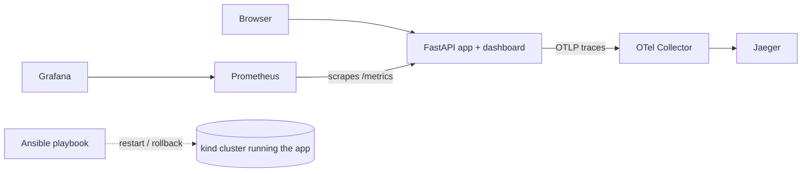

# TraceGuard

A small project where I practice observability and recovery on Kubernetes. It's a fake product-recommendation API. I can make it slow, make it fail, or make it return a *wrong* answer with HTTP 200, and then see how that shows up in traces, metrics and incidents.

**Live demo:** https://traceguard-86lh.onrender.com
(Free tier, so the first load after it's been idle can take about a minute.)

## How it fits together

On Render only the app runs. Jaeger, Prometheus, Grafana, Kubernetes and Ansible are my local setup.

## What's in it
- `/recommend` API with a checker that compares the answer to the expected one
- OpenTelemetry traces and Prometheus metrics
- Incident rules for slow responses, errors, not-ready and wrong answers
- Docker, Docker Compose and a kind (Kubernetes) deployment
- An Ansible playbook that restarts or rolls back the deployment
- A six-page dashboard: Overview, Metrics, Traces, Incidents, Scenarios, Infrastructure. Scenarios A-C run live; D and E are recordings of runs on my local cluster.

## Prerequisites
Python 3.12, and for the full setup Docker, kind, kubectl and ansible-core. I tested on Windows with WSL2 and Docker Desktop.

## Run it
1. App only: `pip install -r requirements-dev.txt`, then `uvicorn app.main:app` and open http://127.0.0.1:8000/. To inject faults locally, set `TRACEGUARD_ENV=local` and `TRACEGUARD_ENABLE_FAULT_INJECTION=true` first.
2. Full stack: `docker compose up -d --build`
3. Kubernetes: `scripts/deploy.sh`, then `scripts/port-forward.sh start`
4. Check everything: `scripts/verify.sh`

Tests: `pytest` (237 pass).

## Deploying
The Render steps are in [DEPLOY_RENDER.md](DEPLOY_RENDER.md).

## Troubleshooting
- A port is already in use: stop the other program or change the port mapping.
- No traces in Jaeger: check the collector logs and that the app can reach it.
- Port-forward stopped after a pod restart: `scripts/port-forward.sh restart`.

## Known limits
- Traces, metrics and incidents are kept in memory and reset when the app restarts.
- One replica per deployment, and Render's free tier sleeps when idle.
- A very short pod restart can be too quick for the 15-second alert.
