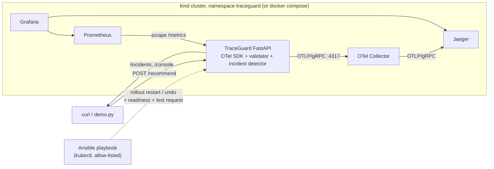

# TraceGuard.

AI observability and controlled self-healing on Kubernetes, demonstrated with a deterministic, AI-like recommendation API.

## Verification status (read this first)

Everything below was **run and observed**, not just written. Tested on Windows 11 with Docker Desktop 4.35.1 (WSL2 backend), working from an Ubuntu WSL2 distro: kind v0.27.0 (Kubernetes v1.32.2), kubectl v1.30.2, Docker Engine 27.3.1, ansible-core 2.21.5 (in a venv), Python 3.12 (container image and test runs).

| Layer | Result | How it was checked |
|---|---|---|
| Automated tests | **84 passed, 0 skipped** | 39 app/telemetry/incident/OTLP tests, 26 `port-forward.sh` tests (fake kubectl), 19 Ansible guardrail tests (fake kubectl). Run in a `python:3.12` container with ansible-core installed. |
| Docker image | **Built and run** | `docker build` (272 MB, non-root UID 10001); also runs inside kind. |
| Docker Compose stack | **Run** | App, Collector, Jaeger, Prometheus and Grafana all up; app container healthy. |
| OpenTelemetry (app -> Collector -> Jaeger) | **Verified end to end** | A request's trace ID is found in Jaeger with 10 spans (`verify.sh` check 3), in both Compose and kind. The OTLP wiring is also unit-tested against a local gRPC receiver. |
| Prometheus | **Verified** | Target `up=1`, 4 alert rules load and evaluate, queries return data. |
| Grafana | **Verified via its API** | Dashboard and both datasources are provisioned and all 11 panels' queries return data after traffic. **Not checked:** how the page *renders* in a browser (no screenshots have been taken yet). |
| Kubernetes (kind) | **Deployed and verified** | 5 pods `1/1 Running`, 0 restarts, probes/resources/non-root context confirmed, all services have endpoints. |
| Scenarios A, B, C | **Run** (Compose, kind) | Latency incident (p95 about 1.5 s) and a critical correctness incident (6/6 wrong answers with HTTP 200 while `/health` and `/ready` stay green). |
| Scenario D (container crash, pod deletion) | **Run, with timings** | See "Measured recovery" below. |
| Scenario E (Ansible) and rollback | **Run** | Dry run, real restart, real rollback (original ReplicaSet restored), probe request traced in Jaeger. |
| `scripts/verify.sh` | **7 of 7 checks PASS, 0 FAIL, 0 SKIP** | Last run against the kind cluster with the final code. |

**Not verified:** the Minikube path (`CLUSTER_TOOL=minikube`), Ansible on a native Windows control node (unsupported by Ansible), macOS, and how the Grafana/Jaeger pages look visually. The timings below are single runs on one laptop, not benchmarks.

`scripts/verify.sh` reports PASS/FAIL/SKIP per check and prints the exact command for every SKIP.

### Measured recovery (single runs, kind on Docker Desktop)

| | Container crash (D1) | Pod deleted (D2) | Ansible restart (E) |
|---|---|---|---|
| What changes | Same pod, `RESTARTS` 0 -> 1 | New pod name, `RESTARTS` 0 | New pod via rolling update |
| Time to Ready | about 3.7 s after the process exit | about 4.4 s after the delete | 9 s for the whole playbook; old pod stayed Ready until the new one was |
| Prometheus `up` | recorded `up=0` (about one 5 s scrape interval) in both runs | recorded `up=0` in one run; **no failed scrape was captured in the other run** | not observed |

`scripts/run-demo.sh D` queries Prometheus after each stage and reports only what it recorded.

## Problem

Dashboards say "healthy" while users get slow, intermittently failing, or **wrong** answers. TraceGuard shows four failure shapes (normal, slow, failing, silently incorrect), how traces + metrics + logs + outcome validation expose each, and how Kubernetes and an operator-run Ansible workflow recover from them.

## Architecture



Collector pipeline (`observability/otel-collector.yaml`): `otlp receiver (4317 gRPC, 4318 HTTP) -> memory_limiter -> batch -> exporters [otlp/jaeger, debug]`, with a `health_check` extension on `:13133`.

## Tech stack

| Component | Why |
|---|---|
| Python + FastAPI | Small, typed API; easy to instrument. |
| OpenTelemetry SDK + `opentelemetry-instrumentation-fastapi` | Vendor-neutral traces; the same telemetry can go to Jaeger today and another backend later by changing the Collector exporter. |
| OTel Collector | Decouples the app from backends (batching, retry, fan-out). |
| Jaeger | Simple trace UI. |
| Prometheus + `prometheus_client` | Low-cardinality metrics (rates, p95 from histograms, readiness, correctness, incident counts). |
| Grafana | Provisioned dashboard `TraceGuard overview` (11 panels, all PromQL against live data). |
| Docker, kind (or Minikube), kubectl | Local Kubernetes; probes, resources, rolling updates, pod recreation. |
| Ansible | Auditable, repeatable operator workflow with validation, check mode and verification. |

Ports: app 8000, Jaeger UI 16686, Prometheus 9090, Grafana 3000, Collector OTLP 4317/4318 (health 13133, compose publishes 4317/4318). Dependency chain: app -> collector -> jaeger; prometheus -> app; grafana -> prometheus, jaeger.

## Application

| Endpoint | Purpose |
|---|---|
| `GET /health` | Liveness. |
| `GET /ready` | Readiness. |
| `POST /recommend` | `{user_id, category, budget}` -> best in-stock product within budget, plus a `correctness` verdict and `trace_id`. |
| `POST /simulate-failure` | Fault injection (`slow`, `error`, `wrong_result`, `not_ready`, `unhealthy`, `crash`, `none`). **Returns 403 unless `TRACEGUARD_ENV=local` and `TRACEGUARD_ENABLE_FAULT_INJECTION=true`.** Default environment is `production`, so the safe default is "off"; a flag alone is not enough. |
| `GET /metrics` | Prometheus metrics. |
| `GET /incidents`, `GET /console` | Incident records (JSON) and a small live HTML console with Jaeger links. |

Spans per request: server span (FastAPI instrumentation) with children `recommend.validate_input`, `lookup_catalog`, `compute_recommendation`, `validate_business_rules`, `build_response`. Each child has `traceguard.operation`, `traceguard.status`, `traceguard.duration_ms`, `traceguard.fault_scenario`. Health/ready/metrics are excluded from tracing. User IDs are stored only as a truncated SHA-256 span attribute; metric labels are bounded enums (route template, method, status, scenario, result, incident type). Logs are JSON with `trace_id`/`span_id`.

**Correctness check:** the pipeline's choice is compared with an independent golden reference (`domain.expected_recommendation`) plus invariants (in budget, in stock). `wrong_result` simulates a stale ranking that serves the runner-up: HTTP 200, healthy probes, wrong answer.

**Incident rules** (`app/incident_detection.py`, deterministic, offline, thresholds from env): p95 latency > 1000 ms; 5xx rate > 20%; any incorrect outcome in the window (threshold 0); readiness false. Window: last 50 `/recommend` requests, minimum 5 samples for latency/error rules. Each incident has type, detection time, severity, evidence, trace ID (a real one from an affected request, or `null`), investigation steps, remediation, and `root_cause_confirmed: false`. These are **symptoms**; a trace is an example, not proof of cause.

## Setup

### Prerequisites

- Always: Python 3.11 or 3.12. The pinned dependencies (for example `pydantic-core`) have no wheels for Python 3.14 yet, so on a host with 3.14 run the tests in a container: `docker run --rm -v "$PWD":/src:ro python:3.12-slim sh -c 'pip install -r /src/requirements-dev.txt && cp -r /src /w && cd /w && python -m pytest'`.
- Compose path: Docker + Docker Compose v2.
- Kubernetes path: Docker, [kind](https://kind.sigs.k8s.io/) (or Minikube, untested), kubectl.
- Ansible path: `ansible-core` in a venv on Linux/macOS/WSL2 (Ansible has no native Windows control node).
- **Tested Windows setup:** Docker Desktop (WSL2 backend) + an Ubuntu WSL2 distro, with the repo cloned into the WSL filesystem (`~/traceguard`, much faster than `/mnt/c`). Run the `scripts/*.sh` from that Ubuntu shell; they are LF-only and executable (`.gitattributes`). Pure-Python steps also work in PowerShell.

### 1. App only (no Docker)

```bash
python -m venv .venv
source .venv/bin/activate            # PowerShell: .venv\Scripts\Activate.ps1
pip install -r requirements-dev.txt
python -m pytest                     # unit + OTLP wiring tests
TRACEGUARD_ENV=local TRACEGUARD_ENABLE_FAULT_INJECTION=true uvicorn app.main:app --port 8000
# PowerShell: $env:TRACEGUARD_ENV="local"; $env:TRACEGUARD_ENABLE_FAULT_INJECTION="true"; uvicorn app.main:app --port 8000
```

Without `OTEL_EXPORTER_OTLP_ENDPOINT` the app runs but exports no traces.

### 2. Full observability stack with docker compose (fastest demo)

```bash
docker compose up -d --build
```

Open Jaeger http://localhost:16686, Prometheus http://localhost:9090, Grafana http://localhost:3000 (dashboard is the home page), console http://localhost:8000/console.

### 3. Kubernetes (kind)

```bash
scripts/deploy.sh                # creates kind cluster 'traceguard', builds + loads image, deploys app and observability
scripts/port-forward.sh start    # 8000, 16686, 9090, 3000 on 127.0.0.1; detached, survives the launching shell
scripts/port-forward.sh status   # per service: running/stopped; exit 0 only if every port accepts connections
scripts/port-forward.sh stop     # kills only the forwards this script started (tracked in .pf/*.pid)
scripts/port-forward.sh restart traceguard   # every subcommand accepts one service name; default is all four
```

Minikube (untested): `CLUSTER_TOOL=minikube K8S_CONTEXT=minikube scripts/deploy.sh`; the recovery playbook only accepts `kind-traceguard`, so for Minikube edit its literals deliberately. Use `127.0.0.1` rather than `localhost` on Windows to avoid IPv6 fallback delays (measured here: about 2 s per request with `localhost`).

### 4. Ansible

```bash
python3 -m venv ~/.venvs/ansible && ~/.venvs/ansible/bin/pip install ansible-core   # isolated, not system Python
export PATH=~/.venvs/ansible/bin:$PATH
ansible-playbook -i ansible/inventory.ini ansible/recover-deployment.yml --check              # dry run
ansible-playbook -i ansible/inventory.ini ansible/recover-deployment.yml                      # rollout restart
ansible-playbook -i ansible/inventory.ini ansible/recover-deployment.yml -e recovery_action=rollback
```

The playbook validates the request, reads current state, restarts or rolls back, waits for `rollout status`, then probes `/ready` and sends a real `/recommend` **inside the pod** via `kubectl exec` (so it does not depend on a port-forward that dies with the old pod), asserts the result is correct, and prints a SUCCESS/FAILURE summary. `--check` runs only the read-only steps and prints what it would do. Rollback needs at least two recorded revisions and refuses otherwise.

**Guardrails.** Only one target is possible: deployment `traceguard` in namespace `traceguard` of context `kind-traceguard`. Because `-e` extra-vars always override playbook variables, these limits are **literals inside the playbook's assert and in every `kubectl` argument**, not variables, and the in-pod probe is loaded from `ansible/files/probe.py` by a literal path. `-e` therefore cannot widen the targets, replace the command, or inject code into the pod; `tests/test_ansible_guardrails.py` proves it with a fake `kubectl` that logs every call (refusals happen before any `kubectl` call; all calls are pinned). This is a guardrail against mistakes and untrusted inputs, not a privilege boundary: whoever can edit the playbook or run `kubectl` directly can do more. To target another cluster (for example Minikube), edit the literals deliberately.

## Demo scenarios

Run any with `scripts/run-demo.sh A|B|C|D|E|all` (A-C also: `python scripts/demo.py A|B|C|all`).

| | What happens | What to look at |
|---|---|---|
| **A Normal** | 6 good requests. | `/console`: no incidents. Jaeger: 5 child spans per trace. Grafana: request volume, 100% correctness. |
| **B Slow** | `slow` fault adds 1500 ms inside `lookup_catalog`. | Latency incident (p95 > 1000 ms) with the slowest request's trace ID; in Jaeger the `lookup_catalog` span dominates and carries `traceguard.injected_delay_ms`. |
| **C Silent failure** | `wrong_result`: HTTP 200 on every request, `/health` and `/ready` green. | Correctness incident; `validate_business_rules` span has `expected_sku`/`actual_sku` and a `business_outcome_mismatch` event; Grafana "Business correctness rate" drops while availability stays UP. Why infra health misses it: nothing in probes or status codes encodes "was the answer right". |
| **D Pod failure** | D1: `crash` makes the process exit -> kubelet restarts the **container** (same pod, RESTARTS +1). D2: `kubectl delete pod` -> ReplicaSet creates a **new pod** (new name). | Readiness gates traffic until the new pod is Ready. Measured: about 3.7 s (D1) and 4.4 s (D2) to Ready. The "Process restarts" panel increments for each; Prometheus `up` drops to 0 **only if a scrape lands inside the outage** (it did in most runs, not all). While nothing serves traffic the app cannot emit traces; earlier traces stay in Jaeger (until Jaeger itself restarts: in-memory storage). In-memory fault state, the incident window and incident history reset, which is why a restart "fixes" injected faults. |
| **E Ansible** | Inject `wrong_result`, see the correctness incident, then run the playbook. | `--check` output, rollout status, post-recovery correct result. |

**Container restart vs pod recreation vs application-level recovery.** Container restart: kubelet restarts a crashed or liveness-failing container inside the same pod (same name, RESTARTS increments, pod IP/volumes preserved). Pod recreation: the pod object is gone (deleted, evicted, node loss, rollout) and the ReplicaSet creates a new one (new name and IP). Application-level recovery: the app heals without either (here: `POST /simulate-failure {"scenario":"none"}` clears an injected fault; in real systems circuit breakers, retries, cache refresh, model rollback).

**Kubernetes vs Ansible.** Kubernetes automatically handles process death, failing liveness probes, unready endpoints and node loss. It cannot know that answers are *wrong* or that a deployment should be rolled back. An operator (or alert-triggered automation) runs the Ansible workflow when a human-level decision is needed: restart to clear bad local state, or roll back after a bad release. It adds pre-checks, an allow-list, a dry run, verification and an audit trail.

### Example output (actual run, local uvicorn, no collector; trace IDs are real but from that run)

Scenario C (silent failure), via `python scripts/demo.py C`:

```
  HTTP 200        7 ms  sku=E-103  correct=False  trace_id=9e2a57936c3dcda9b40d0cd465d48349
  ... (6 requests, all HTTP 200, 6/6 incorrect)
  /health: {'status': 'ok'}  /ready: {'status': 'ready'}  <- infrastructure view is green
  INCIDENT [critical] correctness: 100% of validated outcomes differ from the expected business result although HTTP responses succeeded.
     evidence: {'incorrect_rate': 1.0, 'threshold': 0.0, 'checked': 6}
     Detected symptom only. The attached trace is an example of an affected request; root cause is not confirmed by this record.
```

Scenario B (slow): `window: n=6 error_rate=0% p50=1508.4ms p95=1511.7ms` -> `INCIDENT [warning] latency: p95 latency 1511.3 ms exceeds 1000.0 ms threshold.`

`scripts/verify.sh` (actual final run against the kind cluster, Ansible on `PATH`):

```
PASS  1. API responds (/health, /ready) at http://127.0.0.1:8000
PASS  2a. correct outcome validated as correct
PASS  2b. silent failure: HTTP 200 but outcome flagged incorrect
PASS  3. trace f957c28119905e1a17639d4efee55d0d found in Jaeger with 10 spans
PASS  4a. /metrics exposes traceguard_http_requests_total
PASS  4b. Prometheus scrapes the app (up=1)
PASS  5. Kubernetes deployment is ready
PASS  6. Ansible dry-run and restart workflow succeeded
PASS  7. service returns a correct result after recovery
verify: no failures
```

(Nine PASS lines for the seven numbered checks, because checks 2 and 4 each have two parts.)

## Dashboard coverage

Grafana panels (live PromQL, nothing hardcoded): request volume, error rate, p50/p95, availability (`up`), app readiness, correctness rate, process restarts, active fault scenario, incidents opened by category, open incidents. **Not in Prometheus:** incident trace IDs (a per-request ID as a label would explode cardinality). They are shown on `/console` and `/incidents` with Jaeger links. The Grafana panel text says so. Pod restart *counts from Kubernetes* would need kube-state-metrics, which is not deployed; the restart panel uses `process_start_time_seconds` (Linux containers only).

## Troubleshooting

- **Port already in use** (8000/3000/9090/16686/4317): stop the other process or edit the host side of the port mappings. `scripts/port-forward.sh` reports which forward failed (`.pf/*.log`).
- **`ErrImagePull` / `ImagePullBackOff` in kind:** the image must be loaded: `kind load docker-image traceguard:0.1.0 --name traceguard` (deploy.sh does this). The manifest uses `imagePullPolicy: IfNotPresent` and tag `traceguard:0.1.0`.
- **No traces in Jaeger:** check `docker compose logs otel-collector` (the `debug` exporter logs batches), confirm `OTEL_EXPORTER_OTLP_ENDPOINT=otel-collector:4317` (no `http://` prefix needed for gRPC), and that the app is not run outside Docker with the in-network hostname (use `localhost:4317` then). Batches flush within ~5 s.
- **Pod never Ready:** `kubectl -n traceguard describe pod -l app=traceguard` (probe events) and `kubectl -n traceguard logs deploy/traceguard`. `not_ready` and `unhealthy` fault scenarios are *meant* to do this.
- **Port-forward goes away briefly after a pod is replaced:** a `kubectl port-forward` is bound to one pod. `scripts/port-forward.sh` runs each forward under a small supervisor that reconnects automatically (measured: the forward failed, then served the new process about 3.4 s after the pod was deleted). During a rolling update the forward stays on the old pod until it terminates, so `status` can briefly report "NOT accepting connections"; it recovers by itself within seconds. If it does not (`status` still failing after about 15 s), run `scripts/port-forward.sh restart traceguard`. All subcommands are idempotent and only ever signal the forwards this script started; a forward that cannot start repeatedly gives up instead of looping.
- **Tests fail to install on Python 3.14:** see Prerequisites (use 3.11/3.12 or the container command).
- **Docker build fails with `parent snapshot ... does not exist`:** a transient Docker Desktop image-store error seen once; re-running the build fixed it.
- **Ansible on Windows:** use WSL2.

## Security considerations

- Fault injection is off by default and requires **both** `TRACEGUARD_ENV=local` and an explicit flag; in production config it returns 403 (tested).
- No secrets in the repo; ConfigMap holds non-sensitive settings only. Pod runs as non-root UID 10001, no privilege escalation, all capabilities dropped. `readOnlyRootFilesystem` is not set (not verified).
- Local-demo shortcuts you must not copy: plaintext OTLP, Grafana anonymous Viewer + default admin password, unauthenticated `/incidents` and `/metrics`, `kubectl port-forward` as the only access path.
- Ansible can only act on deployment `traceguard` in namespace `traceguard` of context `kind-traceguard`; the limits are literals in the playbook that `-e` extra-vars cannot override (tested), and there are no cluster-wide operations. It is a guardrail, not a privilege boundary.
- Metric labels and span attributes carry no user IDs, request IDs or trace IDs.

## Cleanup

```bash
scripts/cleanup.sh      # stops port-forwards, removes the compose stack/volumes, deletes the kind cluster 'traceguard'
docker rmi traceguard:0.1.0
```

## Trade-offs and limitations

- **Incident history is in memory.** Incident state, fault state and the sliding window are per process and are lost whenever the pod restarts (observed after both a crash and a pod deletion: 0 incidents in history afterwards). The demo runs 1 replica; with N replicas each pod has its own view. A real deployment would derive incidents from Prometheus/trace data centrally.
- **Short outages may not alert.** `TraceGuardDown` fires only after 15 s of failed scrapes, and a restart takes about 4-5 s, so ordinary pod restarts raise no alert. They show up in the "Process restarts" panel, and whether Prometheus even records `up=0` depends on whether a 5 s scrape lands inside the outage (it did in 3 of 4 observed outages). A quick-restart alert is listed under future extensions but is deliberately not enabled.
- **Forward reconnect window.** After a pod replacement, a local port-forward is unavailable for a few seconds while its supervisor reconnects.
- The golden reference lives in the same codebase as the pipeline: it demonstrates the pattern; real ground truth would be a shadow model, rules service or labelled samples, and a defect shared by both would go undetected.
- Prometheus is scraped through the Service (static target), not per-pod service discovery.
- Jaeger uses in-memory storage; traces disappear on restart.
- Metrics are Prometheus-native, traces are OTLP. OTel metrics/logs pipelines are not implemented.
- Only the paths listed as verified at the top were exercised; Minikube and macOS were not. Timings are single runs on one machine.
- The Ansible guardrails protect against mistakes and untrusted extra-vars; they are not a security boundary against someone who can edit the playbook or run `kubectl` directly.

## Future extensions

- Terraform to provision a cloud cluster (EKS/GKE/AKS) and the same manifests.
- Dynatrace: point an OTLP exporter in the Collector at a Dynatrace OTLP endpoint (token via a secret) and compare to Jaeger. **Not implemented or verified here**; this project does not use Dynatrace.
- Quick-restart alert (for example `changes(process_start_time_seconds[5m]) > 0`). Not enabled on purpose: scenario D showed brief restarts are already visible in the "Process restarts" panel, and `TraceGuardDown` deliberately needs 15 s of failure, so adding a restart alert would add noise.
- Optional LLM-written incident explanations on top of the deterministic records; kube-state-metrics for restart counts; Alertmanager -> webhook -> Ansible (AWX/EDA); a real model/agent with traced tool calls.

## Layout

```
app/            FastAPI app, telemetry, metrics, incident detection     tests/        pytest suite
docker/         Dockerfile                                              k8s/          app + observability manifests
observability/  collector, prometheus, alerts, grafana provisioning     ansible/      recovery playbook
scripts/        build, deploy, port-forward, run-demo, verify, cleanup  docker-compose.yml
```
